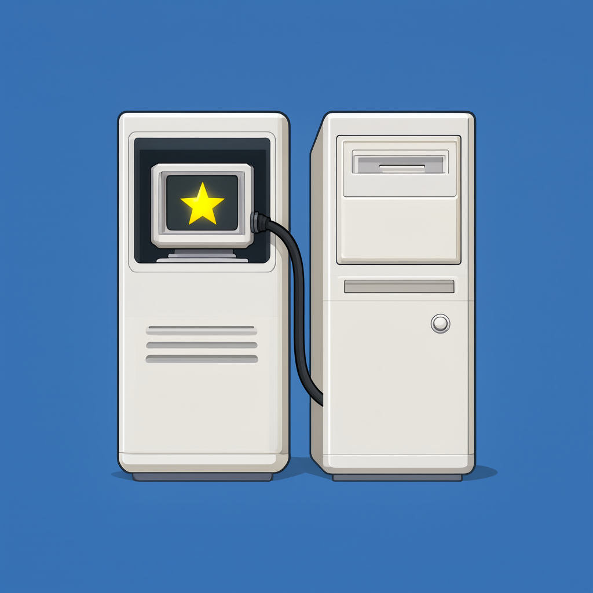
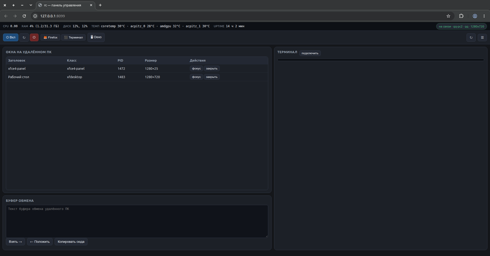
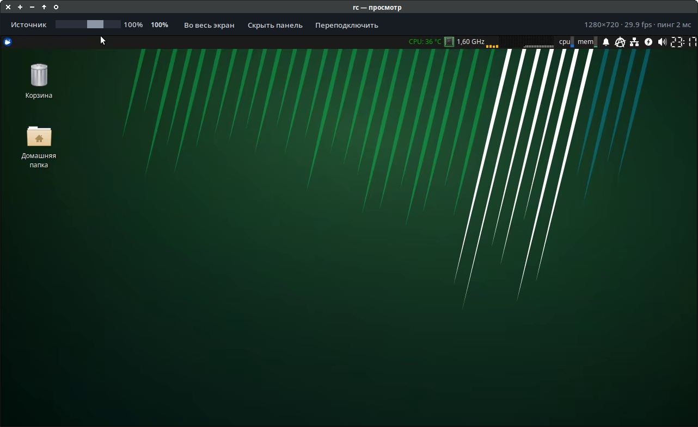

# Remote Control Tool

<p align="center"></p>

[](https://github.com/user/remote-control/actions)


[Русская версия](README.md)

---

## Description

**Remote Control** is a lightweight Linux desktop remote control system. It consists of two components, each on its own machine:
- **Agent** — on the remote machine (target). Captures screen, keyboard, and mouse, streams them over TCP.
- **Panel** — on the controlling PC (controller). Displays the video stream in a browser or native window, sends input back.

## Features

- Screen viewing in real-time via browser or dedicated native window (Tkinter) with MJPEG/H.264/H.265 codecs.
- Keyboard & mouse — full input passthrough with modifiers and hotkeys support.
- Clipboard sync — synchronized clipboards between machines.
- Wake-on-LAN — wake the remote machine over the network.
- Instant connection — no SSH tunnels or certificates needed.
- Native viewer — standalone window with toolbar, zoom, fullscreen, and drag-to-move.
- Input lock — the «Lock» button on the separate window's toolbar: while enabled, mouse movements and clicks are not sent to the remote machine (keyboard keeps working); toggle with the button or Ctrl+Alt+L.
- File manager — browse and upload files from the remote machine.
- Metrics — resolution, FPS, and ping displayed in real-time.

## Screenshots

### Web interface

Web control panel: browser viewer, terminal, file manager, clipboard sync and real-time metrics.



### Native viewer

Standalone window with video stream — no OS window frame, with toolbar, zoom, drag-to-move and a mouse input lock mode («Lock» button / Ctrl+Alt+L).



## Installation

### 1. Remote machine requirements

- Linux (desktop)
- Python 3.12+
- X11 (`DISPLAY=:0.0`)
- Packages: `Pillow`, `psutil`, `python-xlib`

### 2. Install on remote machine (Agent)

`rc-agent` runs **only on the remote machine** — it captures its screen via X11.

```bash
git clone https://github.com/VladislavPlotkin/mbrother.git
cd remote-control
pip install -r requirements.txt
```

Create config `~/.config/rc/agent.json`:

```json
{
  "host": "0.0.0.0",
  "port": 7777,
  "display": ":0.0",
  "fps": 30,
  "quality": 3,
  "codec": "mjpeg",
  "h264_qp": 23,
  "share": "/tmp/rc-share"
}
```

Start the agent:

```bash
python3 -m rc.agent
```

or as systemd service:

```bash
cp service/rc-agent.service ~/.config/systemd/user/
systemctl --user daemon-reload
systemctl --user enable --now rc-agent
```

### 3. Install on controlling PC (Panel)

`rc-panel` runs **only on the controlling PC** — it displays video and sends input. Agent is not needed here since there is no remote screen to capture.

```bash
git clone https://github.com/VladislavPlotkin/mbrother.git
cd remote-control
pip install -r requirements.txt
```

Create config `~/.config/rc/client.json`:

```json
{
  "agent_host": "192.168.100.16",
  "agent_port": 7777
}
```

Start the panel:

```bash
python3 -m rc.client
```

or via Makefile:

```bash
make install
systemctl --user enable --now rc-panel
```

### 4. Install on remote machine via SSH

```bash
make install-ssh HOST=USER@REMOTE_IP
```

## Service management

```bash
# Local
make install          # install services
make uninstall        # remove services

# Remote via SSH
make install-ssh HOST=USER@REMOTE
make uninstall-ssh HOST=USER@REMOTE
```

## Architecture

```
[Panel (port 8099)] <----TCP----> [Agent (port 7777)]
      |                                    |
  Web interface                  Screen capture
  Native viewer                  Mouse/keyboard input
  Clipboard sync                 Process management
  File manager                   Wake-on-LAN
```
